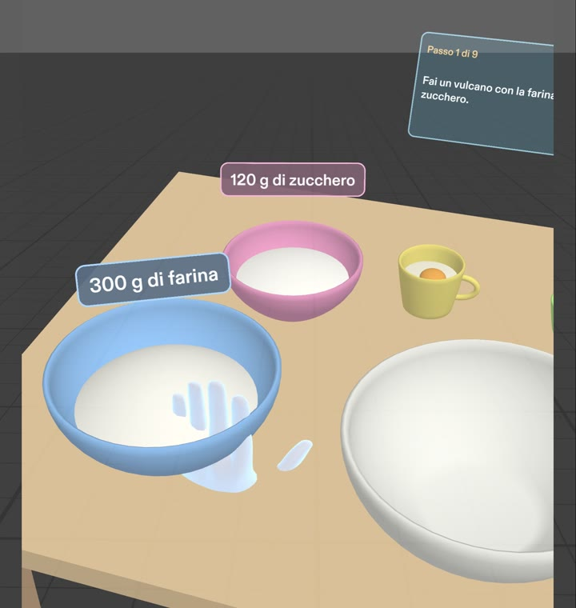
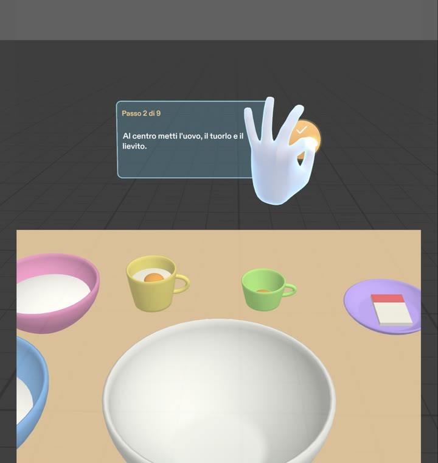
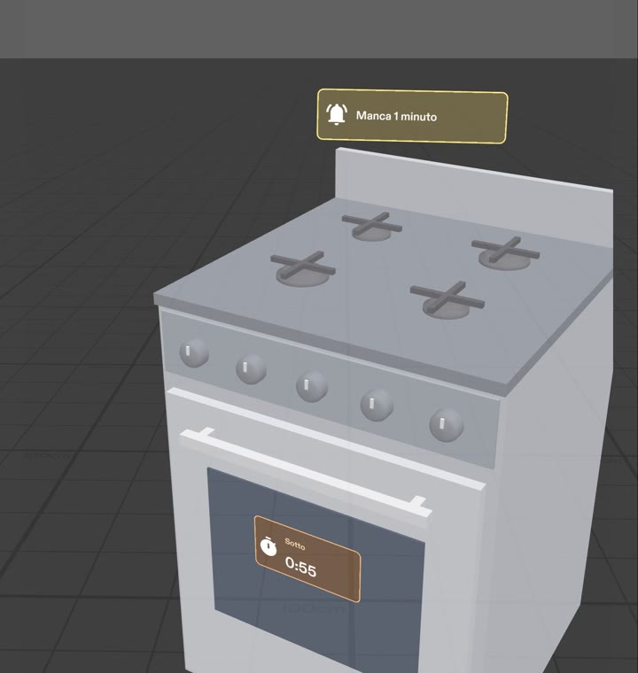
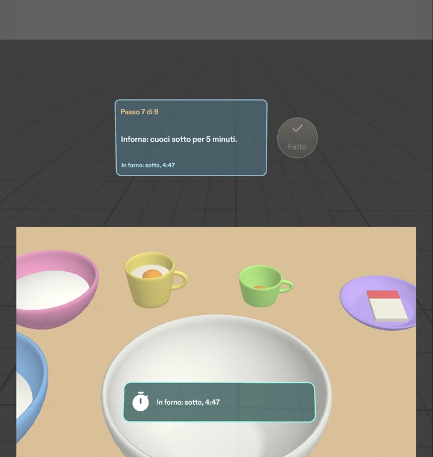
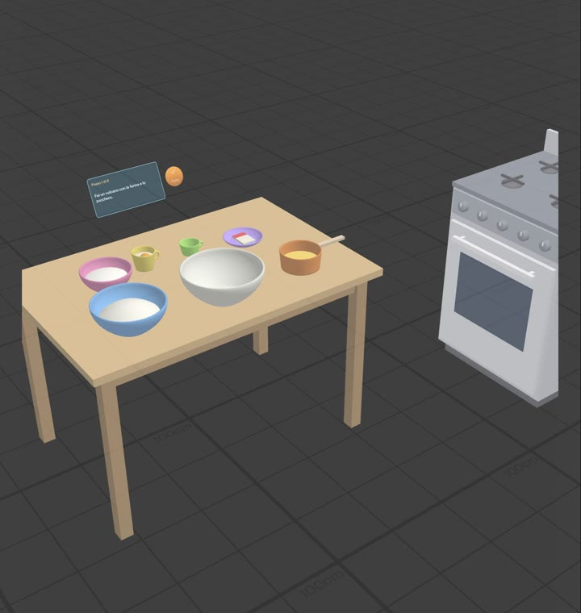

# Biscotti al burro: a Specs Lens for baking butter cookies

A Lens for Specs that puts the recipe on the things it's about. Pinch a container and its dose appears next to it. The current step sits at the back of the table, and one big **Fatto** ("done") button moves you on. The oven timer lives on the oven door, and when the oven is out of view a small recap stays low in view.

Made for [Learn AR with SPECS](https://learn-specs.devpost.com) (Devpost Learn). The idea, the recipe and the design brief are mine. The Lens was built from that brief with CLAD in Lens Studio.

- **Demo video (1:54):** https://youtu.be/wPRcTMHItoQ
- **Design brief:** [`devpost/design-brief.md`](devpost/design-brief.md)

| Pinch → dose | "Fatto" → next step | Timer + reminder on the oven | Recap when the oven is out of view |
|---|---|---|---|
|  |  |  |  |

## Why glasses

When I bake, I keep going back to look at the recipe. With hands covered in butter and flour I can't scroll a phone. On Specs the information sits on the thing it's about: the dose next to each container, the timer on the oven, and my eyes stay on the bowl.

## What it does

- **Doses on the containers.** Six round containers (flour, sugar, melted butter, whole egg, yolk, baking powder) and an empty mixing bowl stand on the table. Pinching a container shows its dose about 10 cm above the rim, for example "300 g di farina". A label goes away when the step that uses it is done.
- **Steps.** The 9 recipe steps, in Italian as I wrote them, show on a card at the back of the table. A big round **Fatto** button (8 cm) moves to the next step.
- **Oven timer.** On step 7, Fatto starts a 5-minute "sotto" (bottom heat) timer on the oven door, 1.2 m to the right of the table. When it ends, a chime plays, the oven says "Ora cuoci sopra" ("now cook on top"), and Fatto starts the 5-minute "sopra" phase. At the end it says "Controlla: devono essere appena dorati" ("check: they should be just golden").
- **Reminders.** 60 s and 30 s before the end of each phase, a reminder bubble appears above the oven with a chime, and hides about 10 s later.
- **Recap.** While a timer runs and the oven is out of view (a real camera-frustum check), a small strip follows gently, low in view, about 1 m away: "In forno: sotto, 3:20".
- **Readable on an additive display.** White text on tinted panels with bright borders, light pastel containers, nothing that relies on black. Everything is at real scale in centimeters. Aimed-at targets highlight.

**Stand-in.** The real version would recognize my table, my bowls (by color and size) and my oven. In this preview the kitchen is virtual: a 120 × 80 cm table 75 cm high, six containers that the Lens already maps to their ingredients, and a gas oven. A pinch on a container stands in for recognizing it.

## Done criteria and LEAF tests

Each done criterion in the brief has a [LEAF](https://developers.snap.com/) scenario. In each one a simulated hand pinches through the real Spectacles Interaction Kit path, and the scenario checks the scene. All four pass in the Lens Studio preview.

| # | Done criterion | Scenario | Result |
|---|---|---|---|
| 1 | Pinching a container shows its own dose next to it (all six) | `c1-dose-labels` | PASS |
| 2 | Pressing "Fatto" shows the next step next to the ingredients | `c2-fatto-next-step` | PASS |
| 3 | "Fatto" on the oven step starts a timer on the oven; reminders at 60 s and 30 s, hidden after about 10 s (both phases) | `c3-oven-timer-reminders` | PASS |
| 4 | With the oven out of view while the timer runs, a recap appears low in view with what's cooking and the time left | `c4-recap-out-of-view` | PASS |

To run them, open the project in Lens Studio 5.24+, open the LEAF panel and run a scenario in the preview. Scenario 3 uses a test-only time scale (`BiscottiFlowController.timeScale`, default 1) so it doesn't wait 10 real minutes.

`demo-tour` is not a test. It is the paced walkthrough I used to record the demo video, with the same simulated hand and head.

**What the tests don't cover:** the chimes, text readability, the recap's follow motion over time, and reach with a real arm. **Logic proven** in the preview; **feel unproven** until real glasses and real dough on my hands.

## How it's built

- Lens Studio 5.24.1, Specs (SPECS 27) base template, TypeScript.
- Spectacles Interaction Kit for pinch and hover, and Spectacles UI Kit for the panels and the Fatto button.
- [`Assets/Scripts/BiscottiFlowController.ts`](Assets/Scripts/BiscottiFlowController.ts) owns all flow state: step, labels, oven timer, reminders and recap. The `Biscotti*UI` scripts are passive views.
- [`Assets/Scripts/BiscottiRecipe.ts`](Assets/Scripts/BiscottiRecipe.ts) holds every Italian string from my recipe.
- `Assets/Scripts/Kitchen/` builds the stand-in kitchen meshes at runtime, so they appear in the Preview, not in the Scene panel.
- `Assets/Tests/Leaf/` holds the LEAF scenarios.

**Process:** I did the `plan-lens` interview (challengepost/learn-specs skill pack), which wrote the design brief. CLAD (the Lens Studio agent plugin for Claude Code) then built the Lens from the brief through the Lens Studio MCP. Finally CLAD wrote and ran the LEAF tests.

## Credits and AI use

- Idea, recipe and design decisions: mine, recorded in `devpost/design-brief.md`.
- Code and scene: generated with CLAD (Claude Code + Lens Studio MCP) from the brief.
- Packages: Spectacles Interaction Kit, Spectacles UI Kit and LEAF by Snap Inc., under their own licenses.
- Demo video: the kitchen footage was generated with AI (Kling on Higgsfield), and the narration is my own cloned voice. The Lens footage is a real recording of the Lens Studio preview.

## License

MIT for the code in `Assets/` (see [LICENSE](LICENSE)). The packages in `Packages/` keep their own licenses.
